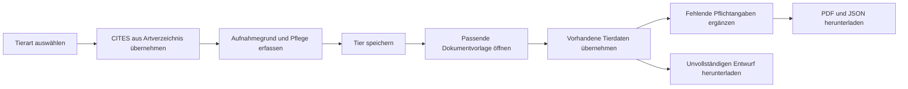

# Dashboard-fixes und verbundene Arbeitsabläufe

Stand: 8. November 2026. Arbeitsbranch: `ux/post-login-workflows`.

## Übernahme des Branches

Quelle: `origin/Dashboard-fixes`, Commit `f5f89e7b` (`fix: ward photo editing, enclosure grid fill, upload id fallback`). Gemeinsame Basis: `6d3b64e2`.

Die Änderungen der neun betroffenen Dateien wurden gegen die gemeinsame Basis in den bestehenden Arbeitsstand übertragen. Der ältere vollständige App-Stand wurde nicht übernommen. In drei Dateien wurden Überschneidungen einzeln aufgelöst:

- `SentinelView.tsx`: Fotoverwaltung ergänzt; neuere Pflege-Paginierung, Fehlerbehandlung und Exportlogik beibehalten. Fotoänderungen bestätigen jetzt zusätzlich, dass die Datenbank tatsächlich eine Zeile geändert hat. Fehlgeschlagene Uploads werden bereinigt. Vorschaubilder werden für das aktive Tier geladen.
- `Wards.tsx`: vollständige Galerie im Editor und Upload-ID-Fallback übernommen; bestehende rollenabhängige Bearbeitungsprüfung beibehalten.
- `smoke-test.sql`: Prüfungen beider Stände zusammengeführt.

Das flexible Gehege-Layout aus `Dashboard-fixes`, Upload-Fallbacks in allen betroffenen Formularen und die zugehörigen Tests sind enthalten. Paketversionen, Auth-/Rollenauflösung, Rollennavigation und Migration 00039 stimmen mit dem gesicherten vorherigen UX-Arbeitsstand überein. Die bestehenden Edge Functions und Sicherheitsmigrationen sind unverändert.

Die Integration ist eine gezielte Übernahme der Änderungen im Arbeitsverzeichnis; es wurde kein Merge-Commit angelegt und nichts gepusht oder live deployt.

## Verbundene Abläufe

- Ein gemeinsames Artverzeichnis wird jetzt auch bei der Erfassung durch Einrichtungen benutzt. Suchantworten werden abgebrochen, ==🔵wenn sie veraltet sind. Ein Artwechsel löscht den bisherigen Schutzstatus; ==ein passender Treffer übernimmt den neuen Wert auch dann, wenn beide Arten denselben Anhang haben. Das Speichern wartet auf die laufende Suche. Vorhandene Angaben bleiben bei einem Ladefehler erhalten. Beim Öffnen eines bestehenden Tiers wird dessen gespeicherte Einstufung nicht durch eine allgemeinere Referenzlistung überschrieben; eine neue Artwahl aktualisiert den Status wieder automatisch.
- Aufnahmegründe werden dauerhaft gespeichert: Beschlagnahmung/Sicherstellung, Fund, Abgabe, Übernahme oder ausdrücklich ungeklärt. Alte Fälle bleiben ungeklärt, statt nachträglich einen Aufnahmegrund zu erfinden.

--> Frage ist, ist es klüger es als solche Angabe mit in die Akte aufzunehmen oder sollte es vorherbestimmt pipelines mit genau diesen Aufnahmegrünen geben? An sich macht es ja keine UNterschied glaube ich und dokumentieren muss man es ja so oder so? Allerdings könnte man die manuelle Eingabe ersparen indem man vor der Anlage den Aufnhamegrund auswählt und anhand dieser dann dei "Pipeline" gestartet wird!

- Tierdaten werden über die Tierverwaltung, Pflege und Behördenansicht bis in den Export weitergereicht: Art, Schutzstatus, Aufnahmegrund, Herkunftsangaben, Pflegeanforderungen, Alter und weitere bereits erfasste Merkmale.

- Die Tierverwaltung gliedert die Aufnahme in Tierbestimmung, Aufnahme/Zuständigkeit und Pflege/Unterbringung. Geschlecht, Aufnahmegrund, Kennzeichnung und Dokumentvorlagen haben Vorauswahlen. „Speichern & Dokumente“ sowie direkte Dokument- und Bearbeitungslinks verbinden die Oberflächen.
- Die kurze Erfassung in Einrichtungen und Behörden führt nach dem Speichern ebenfalls zu den vorbereiteten Dokumenten. Das Behörden-Dashboard bietet direkte Wege zur Tieraufnahme und nationalen Sentinel-Suche.

| Aufnahme / Datenlage | Vorausgewählter nächster Schritt |
| --- | --- |
| Beschlagnahmung / Sicherstellung | Sicherstellungsprotokoll |
| Fundtier | Fundmeldung / Verwahrungsnachweis |
| Abgabe, Übernahme, ungeklärte Aufnahme | Neues Aufnahme- und Übergabeprotokoll |
| Vorhandener CITES- oder EU-Schutzstatus | Zusätzlich Herkunftsnachweise / Übergabe prüfen |
| Endstelle gesucht | Adoptionsvertrag für den späteren Vermittlungsschritt erreichbar |

Alle bisherigen Dokumenttypen und Anhänge bleiben verfügbar. Die Auswahl lässt sich wechseln, ohne die Eingaben der anderen Vorlage zu verlieren.

## Dokumente und Pflichtangaben

Pflichtfelder sind sichtbar als „Verpflichtend“ markiert und mit ihren Eingaben verknüpft. Eine Liste nennt fehlende Angaben und führt direkt zum Feld. Fehlende Angaben verhindern den vollständigen Export; ein ausdrücklich gekennzeichneter Entwurf bleibt möglich. Entwurfsstatus und fehlende Felder stehen auch in JSON und Manifest, auf dem PDF-Deckblatt erscheint „ENTWURF“.

Bei fehlenden Herkunftspapieren kann festgehalten werden, was fehlt und wer es klärt. Zertifikatsnummer, Aussteller und Datum sind erforderlich, wenn „Bescheinigung liegt vor“ gewählt wurde. Die Kennzeichnungsnummer ist abhängig von der gewählten Kennzeichnung. Es werden weder vorhandene Papiere noch eine erfolgte Behördenmeldung voreingetragen. Die Rechtsgrundlage einer Sicherstellung muss aus der tatsächlichen Anordnung übernommen werden.

Die Ausgaben verwenden die Angaben des bearbeitenden Kontos anstelle fiktiver Gesellschafts-, Register- und Adressdaten. Neue Abgabe-/Aufnahmeprotokolle dokumentieren die tatsächliche Übergabe; sie behaupten keine automatische Eigentumsübertragung.

Lange Dokumentdialoge haben einen dauerhaft erreichbaren Schließen-Knopf und einen eigenen Scrollbereich. Nicht heruntergeladene Eingaben lösen beim Schließen des Dialogs, Wechsel des Tiers oder Wechsel der internen Dokument-/Pflege-Tabs eine Rückfrage aus. Die Eingaben werden innerhalb des offenen Arbeitsbereichs gehalten, aber nicht als dauerhafte serverseitige Dokumententwürfe gespeichert. Nach dem Download ist das ZIP die exportierte Fassung.

## Grenzen der Automatik

„Verpflichtend“ bezeichnet die Vollständigkeitsregeln der jeweiligen App-Vorlage. Es ist keine allgemeine rechtliche Einstufung für jede Tierart und jedes Bundesland. Die vorhandene `cites_species`-Referenz liefert CITES-Listungen; sie ersetzt keine aktuelle Prüfung von EU-Anhängen, Herkunft, Ausnahmen und konkreten Bescheiden. Ein fehlender Treffer wird ausdrücklich nicht als „ungeschützt“ bewertet. Zusammengesetzte Listungen bleiben erhalten und werden zur Prüfung hervorgehoben.

Die generierten Unterlagen sind Falldokumente zur Prüfung und Unterschrift. Sie ersetzen keine von einer Behörde ausgestellte Genehmigung oder CITES-Bescheinigung und werden nicht automatisch an eine Behörde versandt. Die im vorherigen [UX-Review](POST_LOGIN_UX_REVIEW.md) genannten fehlenden externen Integrationen bleiben separate Produktaufgaben.

## Prüfung und Auslieferung

- 34 Unit-Tests bestanden, einschließlich Dokumentauswahl, Schutzstatus-Unterscheidung, Pflichtfeldregeln und Upload-Fallback.
- 27 Browsertests bestanden: alle Rollen, mobile/desktop Darstellung, Mischrollen, Art → Speicherung → Dokument → tatsächlicher ZIP/JSON-Inhalt, Entwürfe, Schutz vor Verwerfen sowie Foto-Upload/-Entfernung und Fehlerbereinigung.
- Datenbanktests bestanden: vollständige Migrationsfolge, gültige Aufnahmegründe, sichere Vorgabe für Altfälle, bestehende Eigentümergrenzen und vorherige Sicherheits-/Transaktionstests.
- TypeScript, ESLint und Produktionsbuild bestanden. ESLint meldet weiterhin fünf bestehende Fast-Refresh-Warnungen. Die bestehenden Build-Hinweise zu Zod-Kommentaren und dem optionalen PixelBlast-Chunk bleiben bestehen.
- Öffentlicher Einstieg plus Landing: 148,06 kB gzip; Authentifizierung und PDF-Bibliotheken bleiben verzögert geladen.
- Tests verwenden isolierte Daten und greifen nicht auf echte Supabase-, Clerk- oder E-Mail-Konten zu.

Vor dem Frontend-Deployment muss die Datenbank bis **00041** migriert sein. Auf einem vorhandenen Stand 00038 zuerst 00039, dann 00040 und `external-supabase/migrations/00041_authority_ward_assignment_requests.sql` anwenden. Auf Stand 00039 die Migrationen 00040 und 00041 ergänzen; auf Stand 00040 nur 00041. Die Anfangsmigrationen nicht erneut auf einer bestehenden Datenbank ausführen. Bestehende Daten bleiben erhalten; Behördenzuweisungen laufen jetzt über Sentinel-Zustimmung. Der Umkreisfilter verwendet PLZ/Ort (ohne Straße/Hausnummer) und ist auf 25/50/100 km einstellbar, Standard 25 km.

## Verwendete Leitlinien

- [W3C WAI: Formulare](https://www.w3.org/WAI/tutorials/forms/): klare Beschriftungen, zusammengehörige Eingaben und verständliche Rückmeldungen.
- [W3C WAI: Eingabevalidierung](https://www.w3.org/WAI/tutorials/forms/validation/): erkennbare Pflichtfelder und konkrete Hinweise auf fehlende oder ungültige Angaben.
- [BfN: Artenschutzrechtliche Regelungen](https://www.bfn.de/regelungen): CITES-Anhänge I–III und EU-Anhänge A–D sind getrennte Klassifikationen; zusätzlich gelten nationale Bestimmungen.
- [BfN: Genehmigungen und Bescheinigungen](https://www.bfn.de/genehmigungen-und-bescheinigungen): amtliche Dokumente bleiben Teil der zuständigen Verwaltungsverfahren.
